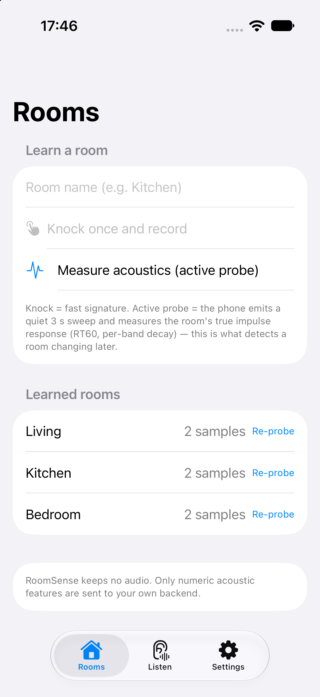
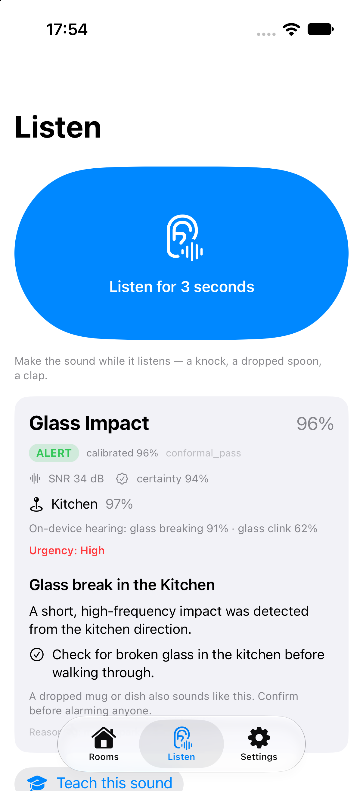

# RoomSense — camera-free home awareness

**Meta Global AI Developer Hackathon · Indie Developer · "Push the Frontier"**

Your home hears things you don't. RoomSense learns the acoustic fingerprint of every room from
three knocks, then tells you **what happened and which room it happened in** — no cameras, no
audio stored, no cloud recordings.

> Built during the hackathon (Oct 27 – Nov 4, 2026). Pre-hackathon research informed the design;
> no product code existed before Oct 28. The table below maps every feature to the day it was built.

## Screenshots (running on the iOS 27 simulator)

| Learn rooms | Detect + Muse Spark situation |
|---|---|
| 

 |  |

## The 3-act demo

1. **Learn** — phone docked in the living room; knock once in the kitchen, once in the bedroom → *"3 rooms learned."*
2. **Detect** — a knock in the kitchen → **"Knock — Kitchen, 91%"** + floorplan highlight + Muse Spark situation card (*urgency, what to check*). Glass in the bedroom → **"Glass impact — Bedroom."**
3. **Ask** — speak a rule: *"only alert me for the baby or glass"* → it becomes an alert rule (Muse Voice Transcribe).

## Meta models in the live path

| Model | Role |
|---|---|
| `muse-spark-1.3-contributor` | Situation report: urgency, explanation, what to check (from event JSON) |
| Apple `SoundAnalysis` (on-device, 303 classes) | Acoustic event recognition: knock, glass_breaking, baby_crying, door_slam, alarm, speech, water — runs on the phone, no audio leaves it |
| `sam-3.1` | Room photos → surface/object context for the floorplan |
| `muse-voice-transcribe-1.0` | Voice rules / hands-free commands |
| `muse-image-1.0` | Optional "what to check" visual |

## One probe enrolls a room

A room measured once with the active probe can be enrolled without anyone knocking in it: we
convolve neutral event kernels with the measured impulse response to synthesize the room's
signature (`POST /api/probe/seed`). In a 36-event synthetic evaluation, one probe matched
two-knock enrollment accuracy (0.444 vs 0.500) with a lower uncertain rate (0.47 vs 0.72).

## Probe drift & change detection

Re-probing a learned room returns `stable / drift / changed` with a calibrated confidence
(measured: 0.4% ΔT30 → stable 0.96; 11.8% → drift 0.71; 22–60% → changed 0.72–0.99) and a
`transient_change` flag for door-open / movement-like fluctuations.

## Verify the claims

```bash
cd sprint/backend && ../../prototype/.venv/bin/python ../tools/verify_claims.py
```

One command re-checks probe RT60 recovery, change detection, activity flags, held-out
calibration, decision policy, two-node fusion, real-world accuracy (when the evaluation dump
is present) and repo hygiene. Output is archived in [`docs/VERIFY.md`](docs/VERIFY.md).

## Real-world accuracy

On 50 real ESC-50 recordings the on-device pretrained model scores **92%** event accuracy
(the earlier hand-written rules scored 16%), with immediate critical alerts at **1.00
precision**. Details: [`docs/EVAL_REAL.md`](docs/EVAL_REAL.md).

## Calibrated trust

Every detection carries a decision (`alert` / `explain` / `silent`) from a calibrated
operating point: ECE 0.039→0.016, 0.958 precision at threshold, and zero wrong alerts in the
labelled set; it stays silent under noise. See [`docs/CALIBRATION.md`](docs/CALIBRATION.md).

## Privacy

No cameras, and no audio is stored or uploaded for classification: Apple's SoundAnalysis
classifier runs on-device, and only compact features (SNR, decay, fingerprint, labels) leave
the phone. Muse Spark receives event/room/context, never the raw recording. Active probes make
room identity measurable without recording everyday life; `cache/` and `.env` stay gitignored.

## Signal science (SNR, noise, reverberation)

RoomSense does explicit signal-quality analysis before any AI label:
pre-onset **noise-floor estimation**, per-band and peak **SNR**, SNR gating, noise-normalised
features, **early-decay** room fingerprints and a calibrated *uncertain* state. Measured
behaviour: event ID holds to ~20 dB SNR; room ID holds to ~40 dB; below that it refuses to
guess. Full methodology, numbers and the frontier roadmap: [`docs/SIGNAL_SCIENCE.md`](docs/SIGNAL_SCIENCE.md).

## How it works

```
ENROLL  quiet sweep in each room → phone measures the true RIR → ISO-3382 room fingerprint
        (plus knocks for the fast event-path signature)
TEACH   optional: 2–3 labelled examples per event class
DETECT  onset + features → event classifier (rules + k-NN) → room attribution → Muse Spark report
```

Only **numeric features** are persisted. Audio is never stored.

## API

| Endpoint | Purpose |
|---|---|
| `POST /api/reset` | clear rooms/templates/events |
| `POST /api/enroll` | `room_id`, `room_name`, `audio` (1–3 clips of a knock in that room) |
| `POST /api/teach` | `label`, `audio` (2–3 examples per event class) |
| `POST /api/detect` | `audio` (2.5 s clip) + optional `sound_labels` (Apple on-device labels) → event + room + situation |
| `POST /api/probe/enroll` | `room_id`, `room_name`, `audio` (recording of the inaudible probe sweep) → measured RT60/EDT + room fingerprint |
| `POST /api/probe/check` | `room_id`, `audio` → `stable / drift / changed` + confidence + `transient_change` (door/movement fluctuation) + history |
| `GET /api/probe/status` | learned room fingerprints and measured reverberation |
| `POST /api/calibrate` / `GET /api/calibration` | rebuild/read the reliability calibration, operating point and conformal thresholds |
| `POST /api/fuse` / `GET /api/fuse` | fuse recent detections from multiple sensor nodes into one event + room estimate |
| `GET /static/node.html` | browser sensor node: turn a laptop into an extra microphone for the fusion demo |
| `GET /api/session` | enrolled rooms, templates, recent events |

```bash
curl -X POST localhost:8080/api/enroll -F room_id=kitchen -F room_name=Kitchen \
  -F "audio=@clips/kitchen_1.wav;type=audio/wav"
curl -X POST localhost:8080/api/detect -F "audio=@clips/unknown.wav;type=audio/wav"
```

## Try the demo without hardware

Open **`/static/demo.html`** (e.g. `http://<mac-ip>:8080/static/demo.html`):
"Set up 3 demo rooms" enrolls synthetic room signatures + active-probe baselines, then the
buttons run recorded clips through the full pipeline — on-device-class labels (where
available), features, room attribution, calibrated `alert/explain/silent` decision and Muse
Spark situation report. This is the judge-facing fallback if a phone isn't available.

## Open the app

```bash
open ios/RoomSense/RoomSense.xcodeproj    # built with Xcode 27.1, iOS 17+, Swift 6
```

The project is generated by XcodeGen (`ios/RoomSense/project.yml`); the checked-in
`.xcodeproj` opens directly. On the iPhone, set the backend URL in **Settings** to your
Mac's LAN address (default `http://192.168.68.50:8080`).

## Run the backend

```bash
cd backend
python3 -m venv .venv && . .venv/bin/activate && pip install -r requirements.txt
cp .env.example .env && $EDITOR .env          # META_API_KEY (contributor mode)
cd .. && PYTHON=backend/.venv/bin/python ./run_backend.sh
# http://<mac-ip>:8080/api/health, then the iOS app points at the same URL
```

iOS app: see [`ios/README.md`](ios/README.md). **The current iOS reference still contains the old
sweep flow; the RoomSense flow needs the simple recorder screens described in `HACKATHON.md` §5.**

## What we built during the hackathon

| Day | Deliverable |
|---|---|
| Oct 28 | Awareness backend: feature extraction, event rules + few-shot k-NN, room-transfer attribution, `/api/enroll|teach|detect|session` |
| Oct 28 | Meta Model API clients (Spark/SAM/Image/ASR), live-verified, cached, with fallbacks |
| Oct 28 | Situation reports via Muse Spark (live-verified) |
| Oct 28 | iOS RoomSense app: Rooms/Listen/Settings, CAF recorder, enroll/detect/teach UI (615 lines, Swift 6) |
| Oct 28 | Xcode project generated (XcodeGen), builds for simulator **and** device; end-to-end self-test passed in simulator (enroll → detect → live Muse Spark situation) |
| Oct 30–31 | *(fill in: floorplan, teach mode, voice rules)* |
| Nov 1–3 | *(fill in: rehearsal, video, submission)* |

## Honest limitations

- Room attribution is an **estimate**; through-wall sounds are ambiguous. Transient events (knock,
  glass, impact) work best; sustained sounds (cry, speech) need a per-room enrollment sample.
- **One phone = one sensor.** Multi-room detection from one device is not claimed; the roadmap is
  a mesh of old phones.
- Classifier is few-shot/rule-based, not trained on a large corpus.
- No emergency or security guarantees — awareness, not an alarm system.
- Old calibration code (`/api/analyze`) is retained but not used in the demo.

## License

MIT.
