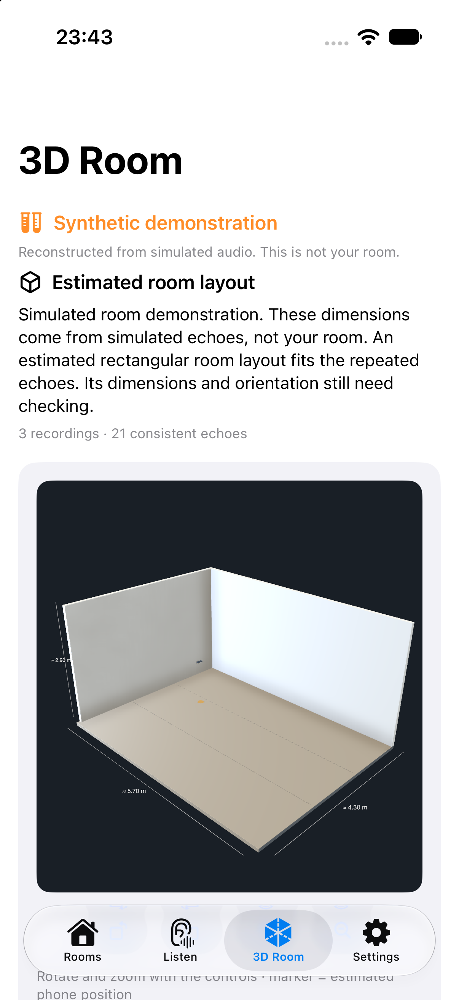
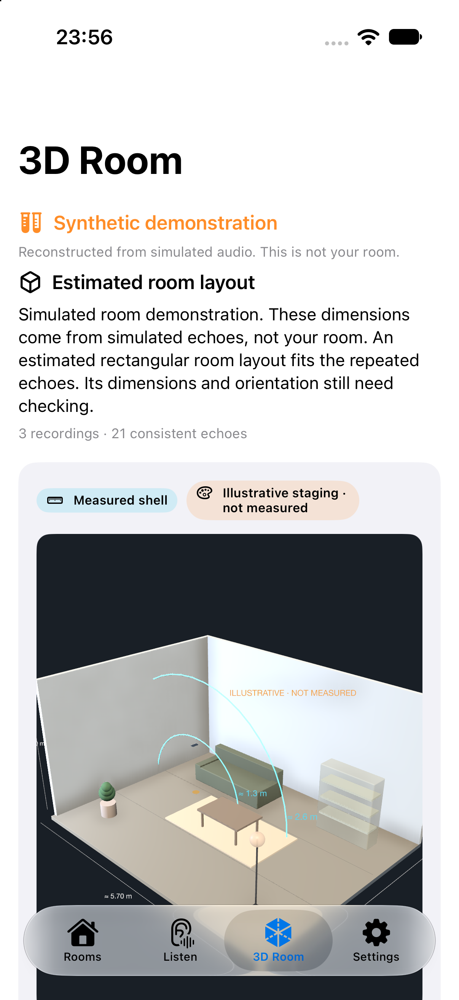

# Echolyra — camera-free home awareness

**Meta Global AI Developer Hackathon · Indie Developer · "Push the Frontier"**

A phone that **measures each room's acoustic fingerprint**, hears what happens in it, says which
room it happened in — with explicit uncertainty. No camera is needed. Recordings are
uploaded to your configured backend for acoustic processing; event classification also runs
on the phone. See the privacy section below for cloud and debug-capture behavior.

## Experimental sound-only 3D room

Open the **3D Room** tab → **Measure with 3 sweeps**, holding the phone stationary in a quiet
room. The backend searches repeatable echo arrival times for possible rectangular layouts,
reports strong echoes the shell cannot explain as **distance-only object candidates**, and shows
an interactive 3D scene: the measured shell, cyan distance rings for acoustic candidates, and an
optional **clearly-labelled illustrative staging** (Meta or procedural) with furniture-like
meshes. Staged objects are a visualisation, **not measured furniture**; no camera, LiDAR, supplied
dimensions or geometry generation is used.




This is an experimental feature: it may say **Couldn’t map this room yet**, show a
**low-confidence shell** you should verify with a tape measure, or show more than one possible
layout. Axes are arbitrary; acoustic object candidates carry only a distance
(direction, identity, size and shape are unresolved), and staged furniture is illustrative, not
detected. Fit error is not calibrated confidence. Actual-room dimension accuracy has not been
established. **Explore synthetic example** runs the same pipeline on simulated probe recordings
and labels that scene as synthetic.

**Ask Meta to review** and **Generate illustrative scene** are optional and require explicit
confirmation. They send only bounded numeric echo/shape diagnostics (and, for staging, the
distance-only candidates + estimated dimensions), never the recording, to the server-configured
model. If Meta is unavailable, staging falls back to a deterministic procedural scene. Contributor mode permits training use. Model suggestions cannot change or validate
the fitted geometry. See [capture protocol, assumptions, and tests](docs/ACOUSTIC_RECONSTRUCTION.md).

**Try it in 30 seconds:** open `/static/demo.html` on the backend (three demo rooms + probe
baselines, recorded clips through the full pipeline) — no phone or install needed.

**Verify every claim:** `cd sprint/backend && ../../prototype/.venv/bin/python ../tools/verify_claims.py`
→ 10/10 checks pass (probe RT60 recovery, change detection, calibration, fusion, real-world
accuracy, documented numbers, repo hygiene). Details in [`docs/VERIFY.md`](docs/VERIFY.md).

**Headline numbers:** 92% event accuracy on 50 real recordings (**90% on 60 unseen clips**),
held-out calibration **ECE 0.1285 → 0.0166**, probe RT60 recovery **0.80 → 0.80 s**, change
detection **0.4% vs 39–60%**, two-node fusion **Living 0.81 / Kitchen 0.19**.

## Screenshots (iOS 27 simulator)

| Learn rooms with the active probe | Detection + calibrated decision + Muse Spark |
|---|---|
|  |  |

Earlier UI: [rooms](docs/screenshots/rooms.png) · [listening](docs/screenshots/listen.png).
Demo video cards: [`docs/media/`](docs/media/).

## What the demo shows (3 minutes)

1. **Measure the room** — the phone plays a sweep you can barely hear and records it; the
   backend deconvolves the true impulse response and reports RT60 per room
   (0.46 / 0.22 / 0.71 s) and stores a fingerprint. No knocking in every room required
   (probe-only enrollment: one RIR is enough).
2. **Detect change** — open a door, re-probe: `drift — ΔT30 11.8% (conf 71%)`; a bigger change:
   `changed — ΔT30 22.3% (conf 72%)`, with a calibrated confidence and activity flag.
3. **Hear + decide** — glass clink: Apple's on-device 303-class model → `glass_breaking` →
   `glass_impact`; room **Kitchen**; decision **ALERT · calibrated 96%** (critical class,
   immediate). A knock is ambiguous: **EXPLAIN · needs_confirmation**, escalating to **ALERT**
   on a second agreeing detection. Muse Spark writes the situation (urgency, explanation,
   what to check, false-alarm check).
4. **Privacy + multi-node** — no camera, no audio sent to Meta; recordings go only to your own backend. A laptop with `/static/node.html`
   joins as a second sensor and fusion reports **Living 0.81 / Kitchen 0.19**.

## Meta models in the live path

| Model | Role |
|---|---|
| `muse-spark-1.3-contributor` | Situation report: urgency, explanation, what to check (from event JSON) |
| Apple `SoundAnalysis` (on-device, 303 classes) | Acoustic event recognition runs on the phone; recordings are also uploaded to the configured backend for feature extraction |
| `sam-3.1` | Room photos → surface/object context for the floorplan |
| `muse-voice-transcribe-1.0` | Voice rules / hands-free commands |
| `muse-image-1.0` | Optional "what to check" visual |

## One probe enrolls a room

A room measured once with the active probe can be enrolled without anyone knocking in it: we
convolve neutral event kernels with the measured impulse response to synthesize the room's
signature (`POST /api/probe/seed`). In a 36-event synthetic evaluation, one probe matched
two-knock enrollment accuracy (0.444 vs 0.500) with a lower uncertain rate (0.47 vs 0.72).

## Probe drift & change detection

Re-probing a learned room returns `stable / drift / changed` with a calibrated confidence
(measured: 0.4% ΔT30 → stable 0.96; 11.8% → drift 0.71; 22–60% → changed 0.72–0.99) and a
`transient_change` flag for door-open / movement-like fluctuations.

## Verify the claims

```bash
cd sprint/backend && ../../prototype/.venv/bin/python ../tools/verify_claims.py
```

One command re-checks probe RT60 recovery, change detection, activity flags, held-out
calibration, decision policy, two-node fusion, real-world accuracy (when the evaluation dump
is present) and repo hygiene. Output is archived in [`docs/VERIFY.md`](docs/VERIFY.md).

## Real-world accuracy

On 50 real ESC-50 recordings the on-device pretrained model scores **92%** event accuracy (and **90%** on 60 unseen external clips, 28 alerts at **0.89 precision**)
(the earlier hand-written rules scored 16%), with immediate critical alerts at **1.00
precision**. Details: [`docs/EVAL_REAL.md`](docs/EVAL_REAL.md).

## Calibrated trust

Every detection carries a decision (`alert` / `explain` / `silent`) from a calibrated
operating point: ECE 0.039→0.016, 0.958 precision at threshold, and zero wrong alerts in the
labelled set; it stays silent under noise. See [`docs/CALIBRATION.md`](docs/CALIBRATION.md).

## Privacy

Apple's SoundAnalysis classifier runs on-device. The app also uploads recordings to the
configured backend for acoustic processing. Awareness/probe routes normally persist derived
features and impulse responses; `DEBUG_CAPTURE=1` explicitly saves audio recordings. Legacy
analysis routes generate audio previews. The new geometry routes do not persist captures or
change enrolled rooms. Muse Spark receives event context (and optional numeric geometry review or staging
spec), rather than raw recordings, through these workflows. Contributor mode permits Meta
to use submitted context and responses for training. `.env` and `cache/` stay gitignored.

## Signal science (SNR, noise, reverberation)

Echolyra does explicit signal-quality analysis before any AI label:
pre-onset **noise-floor estimation**, per-band and peak **SNR**, SNR gating, noise-normalised
features, **early-decay** room fingerprints and a calibrated *uncertain* state. Measured
behaviour: event ID holds to ~20 dB SNR; room ID holds to ~40 dB; below that it refuses to
guess. Full methodology, numbers and the frontier roadmap: [`docs/SIGNAL_SCIENCE.md`](docs/SIGNAL_SCIENCE.md).

## How it works

```
ENROLL  quiet sweep in each room → phone measures the true RIR → ISO-3382 room fingerprint
        (plus knocks for the fast event-path signature)
TEACH   optional: 2–3 labelled examples per event class
DETECT  onset + features → event classifier (rules + k-NN) → room attribution → Muse Spark report
```

Awareness state stores derived features. Debug capture and legacy audio previews are separate
recording paths; see Privacy above.

## API

| Endpoint | Purpose |
|---|---|
| `POST /api/geometry/reconstruct` | 1–3 stationary probe WAVs → estimated layouts, or guidance to try another recording |
| `GET /api/geometry/demo` | same reconstruction pipeline on synthetic acoustic recordings |
| `POST /api/geometry/review` | explicit optional Meta review of allowlisted numeric diagnostics; no audio |
| `POST /api/reset` | clear rooms/templates/events |
| `POST /api/enroll` | `room_id`, `room_name`, `audio` (1–3 clips of a knock in that room) |
| `POST /api/teach` | `label`, `audio` (2–3 examples per event class) |
| `POST /api/detect` | `audio` (2.5 s clip) + optional `sound_labels` (Apple on-device labels) → event + room + situation |
| `POST /api/probe/enroll` | `room_id`, `room_name`, `audio` (recording of the inaudible probe sweep) → measured RT60/EDT + room fingerprint |
| `POST /api/probe/check` | `room_id`, `audio` → `stable / drift / changed` + confidence + `transient_change` (door/movement fluctuation) + history |
| `GET /api/probe/status` | learned room fingerprints and measured reverberation |
| `POST /api/calibrate` / `GET /api/calibration` | rebuild/read the reliability calibration, operating point and conformal thresholds |
| `POST /api/fuse` / `GET /api/fuse` | fuse recent detections from multiple sensor nodes into one event + room estimate |
| `GET /static/node.html` | browser sensor node: turn a laptop into an extra microphone for the fusion demo |
| `GET /api/session` | enrolled rooms, templates, recent events |

```bash
curl -X POST localhost:8080/api/enroll -F room_id=kitchen -F room_name=Kitchen \
  -F "audio=@clips/kitchen_1.wav;type=audio/wav"
curl -X POST localhost:8080/api/detect -F "audio=@clips/unknown.wav;type=audio/wav"
```

## Try the demo without hardware

Open **`/static/demo.html`** (e.g. `http://<mac-ip>:8080/static/demo.html`):
"Set up 3 demo rooms" enrolls synthetic room signatures + active-probe baselines, then the
buttons run recorded clips through the full pipeline — on-device-class labels (where
available), features, room attribution, calibrated `alert/explain/silent` decision and Muse
Spark situation report. This is the judge-facing fallback if a phone isn't available.

## Open the app

```bash
open ios/Echolyra/Echolyra.xcodeproj    # built with Xcode 27.1, iOS 17+, Swift 6
```

The project is generated by XcodeGen (`ios/Echolyra/project.yml`); the checked-in
`.xcodeproj` opens directly. On the iPhone, set the backend URL in **Settings** to your
Mac's LAN address (default `http://192.168.68.50:8080`).

## Run the backend

```bash
cd backend
python3 -m venv .venv && . .venv/bin/activate && pip install -r requirements.txt
cp .env.example .env && $EDITOR .env          # META_API_KEY (contributor mode)
cd .. && PYTHON=backend/.venv/bin/python ./run_backend.sh
# http://<mac-ip>:8080/api/health, then the iOS app points at the same URL
```

iOS app: see [`ios/README.md`](ios/README.md). **The current iOS reference still contains the old
sweep flow; the Echolyra flow needs the simple recorder screens described in `HACKATHON.md` §5.**

## What we built during the hackathon

| Day | Deliverable |
|---|---|
| Oct 28 | Awareness backend: feature extraction, event rules + few-shot k-NN, room-transfer attribution, `/api/enroll|teach|detect|session` |
| Oct 28 | Meta Model API clients (Spark/SAM/Image/ASR), live-verified, cached, with fallbacks |
| Oct 28 | Situation reports via Muse Spark (live-verified) |
| Oct 28 | iOS Echolyra app: Rooms/Listen/Settings, CAF recorder, enroll/detect/teach UI (615 lines, Swift 6) |
| Oct 28 | Xcode project generated (XcodeGen), builds for simulator **and** device; end-to-end self-test passed in simulator (enroll → detect → live Muse Spark situation) |
| Oct 30–31 | *(fill in: floorplan, teach mode, voice rules)* |
| Nov 1–3 | *(fill in: rehearsal, video, submission)* |

## Honest limitations

- Room attribution is an **estimate**; through-wall sounds are ambiguous. Transient events (knock,
  glass, impact) work best; sustained sounds (cry, speech) need a per-room enrollment sample.
- **One phone = one sensor.** Multi-room detection from one device is not claimed; the roadmap is
  a mesh of old phones.
- Classifier is few-shot/rule-based, not trained on a large corpus.
- No emergency or security guarantees — awareness, not an alarm system.
- Old calibration code (`/api/analyze`) is retained but not used in the demo.

## License

MIT.
